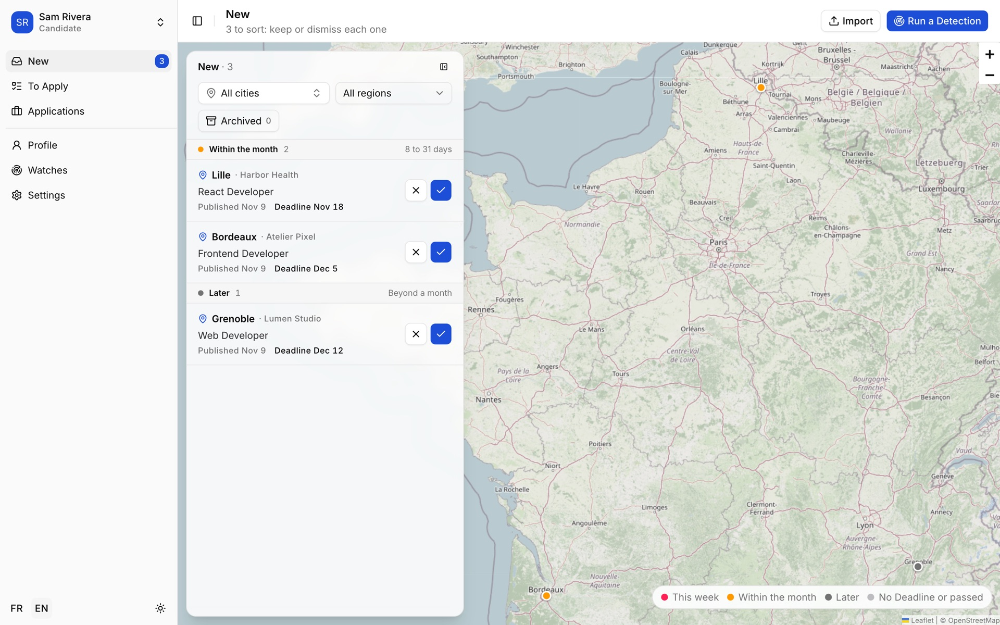
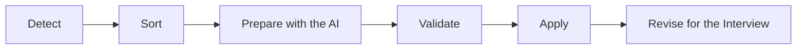
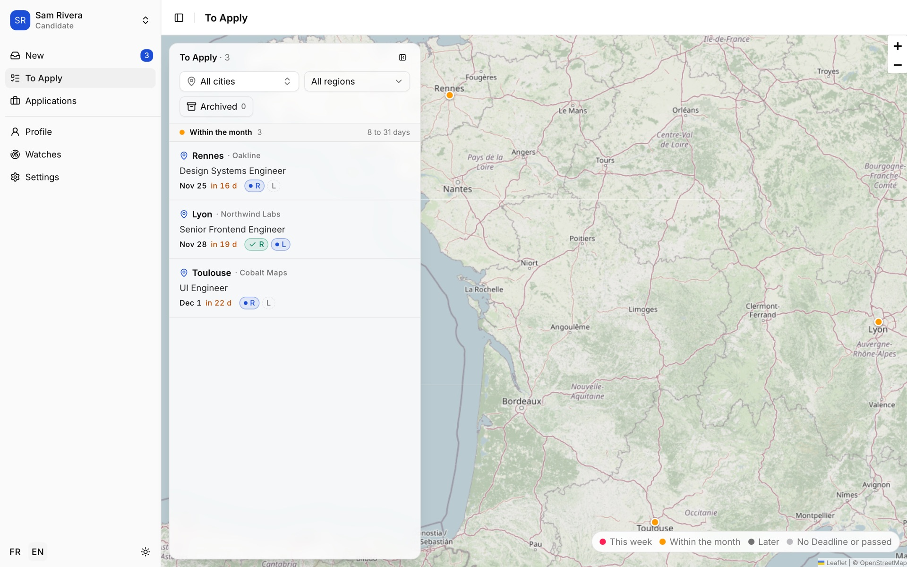
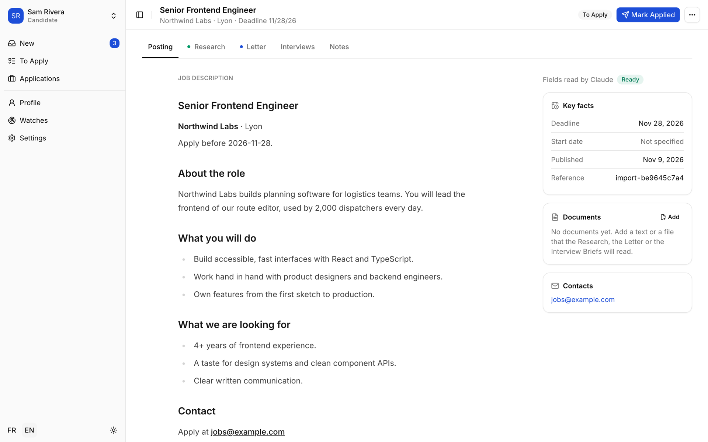
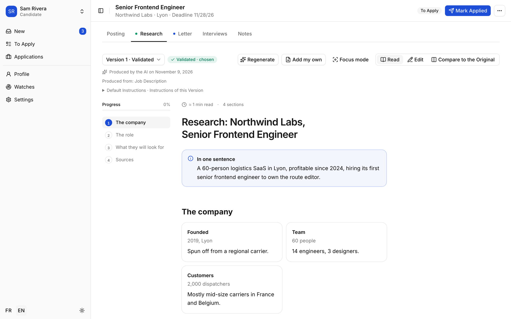
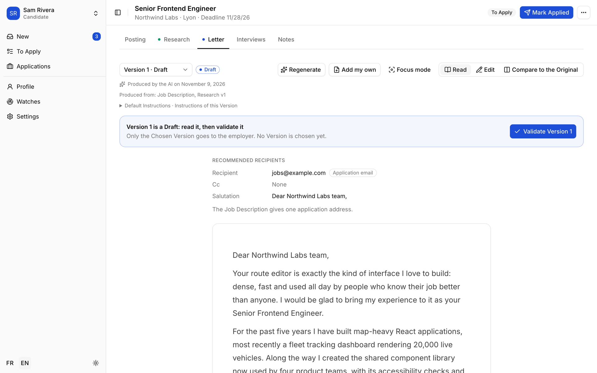
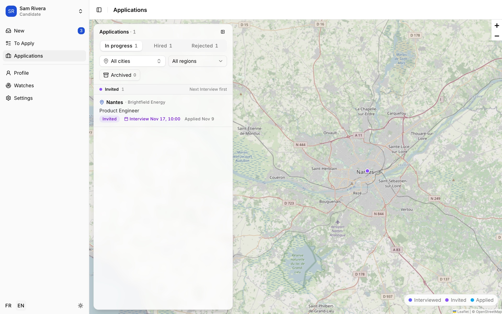
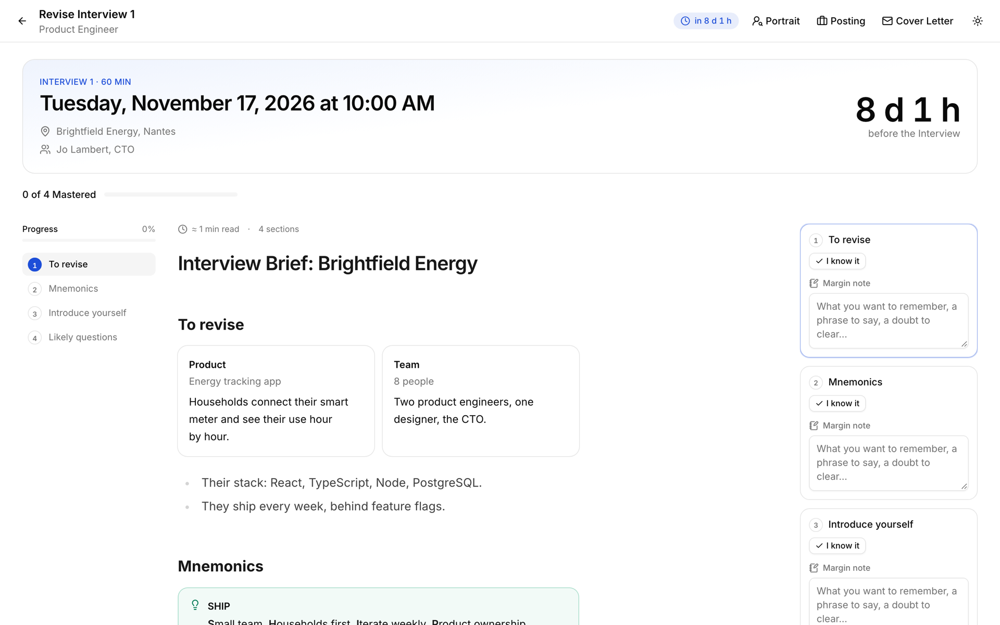
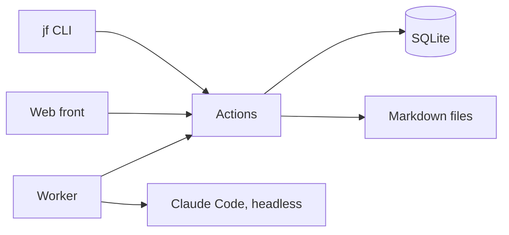

<h1 align="center">Job Finder</h1>

<p align="center">
  <strong>A self-hosted copilot for job hunting: it finds the Postings, the AI drafts, you decide.</strong>
</p>

<p align="center">
  
</p>

Job Finder watches job sites for you, puts every new Posting on a map, and prepares what it takes to apply: a Research on the employer, a cover Letter, a Portrait of the Interviewers and an Interview Brief to revise before the big day. Each of them is written by [Claude Code](https://claude.com/claude-code) and stays a **Draft until you validate it**: nothing is sent, and nothing builds on a text you have not read.

It runs on your own machine, for you and the people close to you. No cloud account, no API key: the AI runs on your Claude subscription.

## How it works



1. **Detect.** Every evening, a Detection reads the job sites you follow and records the new Postings. You get one summary on your phone or by e-mail.
2. **Sort.** Keep a Posting or dismiss it, in one click, from a list sorted by Deadline.
3. **Prepare.** For each Posting you keep, the AI researches the employer, then drafts the Letter from that Research and your Profile.
4. **Validate.** Read, correct and validate each Draft. You see exactly what the AI read and the Instructions it followed, and you can change them.
5. **Apply.** Send the Letter yourself, then mark the Posting Applied. Track every Application up to Hired or Rejected.
6. **Revise.** Before an Interview, study its Brief section by section, take margin notes and mark what you have mastered.

## A tour of the interface

> The screenshots show a fictional Candidate and fictional companies.

### Sort the new Postings

Each new Posting appears on the list and on the map, grouped by how soon its Deadline comes. Keep it to start its Research, or dismiss it.



### Read the Posting

The Job Description, with the key facts the AI extracted and the contacts to write to.



### Research the employer

The Research reads like a short dossier, with cards, timelines and checklists. A table of contents follows your reading.



### Draft the Letter

The Letter builds on the validated Research. It comes with the recipients it recommends, and stays a Draft until you validate it.



### Track your Applications

Every Application in progress, with its next Interview, and the ones that ended as Hired or Rejected.



### Revise before the Interview

A full-screen revision space: a countdown, the Brief section by section, a margin note and an "I know it" for each section.



## Features

- **Watches.** Follow a job site with your own search, within your own Zone. Sources are plug-in modules: the first one reads the French public-sector job site [Place de l'Emploi Public](https://place-emploi-public.gouv.fr/).
- **Import.** Found a Posting elsewhere? Drop its Job Description as a Markdown file: the AI extracts its title, employer, city and Deadline.
- **Four AI Artifacts.** Research, Letter, Portrait of the Interviewers and Interview Brief, plus Artifacts of your own. Each has Versions, which you can regenerate, edit, compare to the AI's Original and validate.
- **Your Instructions.** Read the default Instructions of each module and replace them with your own.
- **Notifications.** A daily Detection Summary through Home Assistant or e-mail.
- **Several Candidates.** One install serves a whole family; each Candidate has their Profile, Watches and Postings.
- **French and English.** The interface speaks both; the Artifacts are written in the language of the Job Description.
- **A CLI too.** Everything the front does, `jf` does from the terminal.

## Getting started

### Prerequisites

- macOS or Linux
- [mise](https://mise.jdx.dev/), which installs Node and the other tools
- [Claude Code](https://claude.com/claude-code), signed in with a Claude subscription, to run the AI modules

### Install and run

```bash
git clone https://github.com/vincentbattez/job_finder.git
cd job_finder
mise install        # Node, the git hooks, npm install and the Prisma client
mise run init       # fills dev-data/ with fake Postings
mise run web:dev    # serves the front on http://localhost:5181
```

The development front reads `dev-data/`, a folder of fake data, and only listens on your machine.

### Use it for real

Your real data lives in `data/`, outside git. Three processes run side by side:

| Process         | Command           | Role                                                    |
| --------------- | ----------------- | ------------------------------------------------------- |
| Front           | `mise run web`    | Serves `data/` on port 5180, open to your local network |
| Worker          | `mise run worker` | Runs the queued AI jobs, one Claude session at a time   |
| Daily Detection | `jf detect`       | Looks for new Postings; schedule it once a day          |

Create your first Candidate from the Settings page, then add a Watch from the Watches page.

> [!WARNING]
> The front has **no authentication**: anyone who reaches it can read and change everything. Keep it on your local network or behind a VPN such as WireGuard, never on the internet ([ADR-0002](docs/adr/0002-front-without-auth-lan-and-wireguard.md)).

### The `jf` CLI

`jf` is on the `PATH` as soon as mise is active in the repo folder.

```bash
jf detect                       # looks for the new Postings of each Watch
jf import posting.md sam        # imports a Markdown Job Description for the Candidate sam
jf list sam                     # lists the Candidate's Postings and their Status
jf run research <reference>     # queues a new Research of a Posting
jf validate <reference> research 1
jf apply <reference>            # marks the Posting Applied
```

Run `jf` alone for the full list, or read the [reference](docs/reference.md).

## Under the hood



- **One action layer.** The CLI, the front and the worker only call `src/actions/`, the single source of truth of each feature.
- **A job queue.** The front only queues a run; the worker runs it in its own process, so restarting the front never cuts an AI session.
- **Plain files.** Every Artifact Version is a Markdown or MDX file you can open, beside the AI's Original.
- **Interchangeable modules.** A Source or a Notification Channel is one folder in `src/modules/` and one line in a registry.
- **Stack.** TypeScript on Node 26, React Router, shadcn and Tailwind v4, Prisma on SQLite, i18next, Vitest and Playwright.

## Development

| Command               | Role                                              |
| --------------------- | ------------------------------------------------- |
| `mise run ci`         | Lint, typecheck and every test, as in CI          |
| `mise run test:unit`  | Vitest: the actions and the architecture rules    |
| `mise run test:e2e`   | Playwright: the flows of the front                |
| `mise run web:dev`    | The front of `dev-data/`, on port 5181            |
| `mise run db:migrate` | Creates a migration from `prisma/schema.prisma`   |
| `mise run db:reset`   | Recreates the `dev-data/` database, then seeds it |

Before you write code, read:

- [`GLOSSARY.md`](GLOSSARY.md): the domain vocabulary, one meaning per word;
- [`CODING_STANDARDS.md`](CODING_STANDARDS.md): the code rules, most of them checked by CI;
- [`docs/adr/`](docs/adr/): the architecture decisions and their reasons;
- [`PRODUCT.md`](PRODUCT.md) and [`DESIGN.md`](DESIGN.md): who the front serves and its visual system;
- [`docs/reference.md`](docs/reference.md): every command, the data folder and the code map.

## Contributing

Issues and pull requests are welcome. Commits follow [Conventional Commits](https://www.conventionalcommits.org/) with a scope, checked by a git hook. Everything in the repo is written in English; the interface copy goes through the i18next resources, in French and English.
